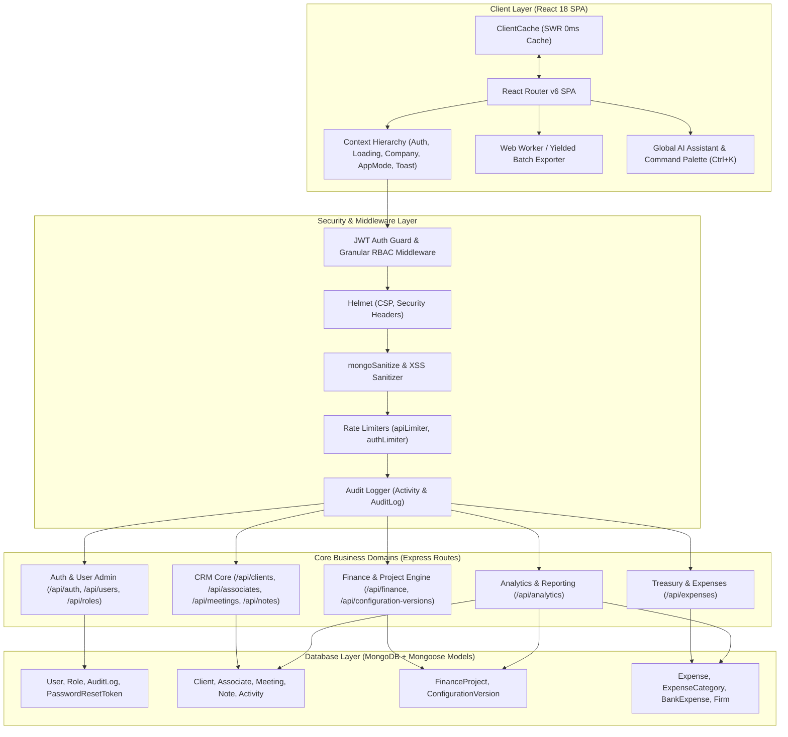
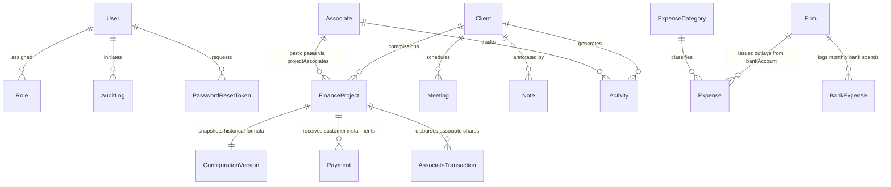

# TRICRM — System Architecture & Codebase Correlation Guide

> **Generated**: November 2026  
> **Repository**: [https://github.com/Krishil1108/tricrm](https://github.com/Krishil1108/tricrm)  
> **Status**: Verified in sync with remote repository `origin/main` (Clean working tree)

---

## 1. Repository & Commit Verification

* **Remote URL**: `https://github.com/Krishil1108/tricrm`
* **Branch**: `main` (up-to-date with `origin/main`)
* **Working Tree**: Clean (0 uncommitted changes, 0 pending merges)
* **Latest Commit Chain**:
  * `cb4e46b` — *fix(branding): replace generic MERN description with professional enterprise metadata, Open Graph cards, and crisp brand favicon*
  * `b355140` — *fix(finance): enforce granular role permissions for top stats metric cards and amounts in FinanceDashboard*
  * `c52f261` — *feat(perf/sec): implement Priorities 3, 4, and 5 - server-side pagination, token rotation, and non-blocking exports*
  * `cda9860` — *feat(perf): implement client-side SWR caching layer for 0ms instant page navigation*
  * `05ee48f` — *Fix Sidebar and route permission leakage by removing fallbackModule and enforcing strict module isolation*

---

## 2. High-Level System Architecture

TRICRM is an enterprise-grade MERN application (MongoDB, Express.js, React 18, Node.js) architected for financial tracking, multi-party associate compensation splits, operational expenses, granular role-based access control (RBAC), and analytics.



---

## 3. Database Entity Relationship & Correlation Model

The application centers around financial milestones, associate commission allocations, client management, and multi-firm operational accounts:



### Key Models & Their Functions

1. **`FinanceProject` (`backend/models/FinanceProject.js`)**
   * **Central Entity**: Maintains project milestones, client links, and financial distributions.
   * **Multiple Associates**: Contains `projectAssociates` array (1–5 associates per project), each with dedicated allocation percentage, total paid, and detailed payment transactions across multiple stages (NEFT, RTGS, Cheque, UPI).
   * **Pre-Save Auto-Calculation**: A Mongoose `pre('save')` hook recalculates `totalReceivedFees` from actual payment entries, protecting against stale or corrupted imported figures.
   * **Formula Breakdowns**: Stores both percentages and auto-derived values for:
     * Profit Margin (`profitMarginPercent` / `profitMargin`)
     * Drawing (`drawingPercent` / `drawing`)
     * Documents (`documentsPercent` / `documents`)
     * Site Visit (`siteVisitPercent` / `siteVisit`)
     * Marketing & Misc (`marketingAndMiscPercent` / `marketingAndMisc`)
     * Office Management (`officeManagementPercent` / `officeManagement`)
   * **Configuration Snapshots**: Holds `configVersion` and `configSnapshot` referencing `ConfigurationVersion` so past projects retain historical calculation rules even when company percentages are modified.

2. **`Client` (`backend/models/Client.js`)**
   * Stores enterprise contact info, company details, GST/billing addresses, notes, and activity logs.

3. **`Associate` (`backend/models/Associate.js`)**
   * Manages freelance architects, structural engineers, and external consultants who collaborate on projects for variable fee percentages.

4. **`Expense`, `ExpenseCategory`, `BankExpense`, and `Firm` (`backend/models/`)**
   * Enterprise multi-firm accounting. Disburses expenses out of specific firm bank accounts, tagged by category (drawings, site visits, rent, supplies) for transparent P&L reports.

5. **`User`, `Role`, `AuditLog`, and `PasswordResetToken` (`backend/models/`)**
   * RBAC infrastructure. Encapsulates bcrypt-hashed passwords, role permissions trees, and security audit logs for critical actions (login, delete, update).

---

## 4. Security, Auth & RBAC Architecture

### 4.1 Token Lifecycle & Silent Token Rotation
* **Startup Integrity**: The server crashes on startup if `JWT_SECRET` is missing, default, or under 32 characters.
* **Token Expiry**: Default 8-hour token duration.
* **Silent Auto-Rotation**: `AuthContext.jsx` runs an auto-refresh timer every **45 minutes**, calling `/api/auth/refresh` with the active token to fetch a freshly minted JWT without prompting the user or disrupting work.

### 4.2 Granular RBAC Matrix
The system uses a 3-tier permission hierarchy:
1. **Admin Super-Override**: Any user with role `Admin` bypasses all checks automatically.
2. **Module Level Access**: Handled in backend routes via `hasModuleAccess('finance')` and on the frontend via `<ProtectedRoute requireModule="finance">`.
3. **Action & Field-Level Visibility**:
   * `canViewAmounts(module)`: If disabled for a role, financial numbers are hidden or masked across tables, metric cards, and reports.
   * Granular permissions for: `add_new_client`, `edit_client`, `delete_client`, `export_clients_excel`, `import_clients_excel`, `view_client_summary_cards`, `view_associates_page`, `export_finance_excel`, and more.

---

## 5. Performance Engineering & Infrastructure

```
User Action / Page Nav
         │
         ├───► Check ClientCache (SWR Engine)
         │           │
         │           ├── [Hit & Fresh] ──► Render immediately (0ms)
         │           └── [Stale / Miss]  ──► Render cached data + fetch background API
         │
         ├───► Heavy Export Requested (XLSX / CSV)
         │           │
         │           └──► yieldToMain() batching in exportWorker.js
         │                      (500-row micro-chunks; 0 main thread lag)
         │
         └───► Entity Updated (Client, Project, Associate)
                     │
                     └──► dataEventManager broadcasts event
                                └──► Invalidate cache + auto-refresh subscriber views
```

1. **Client-Side SWR Cache Layer (`frontend/src/utils/clientCache.js`)**:
   * Uses an in-memory stale-while-revalidate strategy with customizable TTL and stale thresholds.
   * Enables **0ms page-to-page navigation** between Home, Clients, Associates, and Finance Dashboards.
2. **Non-Blocking Background Export Engine (`frontend/src/utils/exportWorker.js`)**:
   * Offloads large multi-sheet Excel/CSV generation into micro-batches (500 items per batch) using `yieldToMain()`.
   * Completely avoids browser freezes when exporting hundreds of records with payment histories.
3. **Data Event Manager (`frontend/src/services/dataEventManager.js`)**:
   * Lightweight pub-sub event bus. When a client or associate is added/edited in a popup modal, all subscriber pages re-fetch or invalidate their cache without full page reloads.

---

## 6. Frontend Navigation & Screen Architecture

```
                                      ┌──────────────┐
                                      │  LoginPage   │
                                      └──────┬───────┘
                                             │ (Token & Role Init)
                                             ▼
                                     ┌───────────────┐
                                     │ ProtectedApp  │
                                     └───────┬───────┘
           ┌───────────────┬─────────────────┼────────────────┬───────────────┐
           ▼               ▼                 ▼                ▼               ▼
      ┌─────────┐    ┌───────────┐    ┌─────────────┐   ┌───────────┐   ┌───────────┐
      │  Home   │    │  Clients  │    │ Associates  │   │  Finance  │   │ Expenses  │
      └────┬────┘    └─────┬─────┘    └──────┬──────┘   └─────┬─────┘   └───────────┘
           │               │                 │                │
           │ (Quick Modals)│ (View Projects) │ (View Projects)│ (Deep Dive)
           │               ▼                 ▼                ▼
     ┌─────┴────┐     ┌─────────┐       ┌──────────┐    ┌───────────┐
     │ Calendar │     │ Client  │       │Associate │    │  Project  │
     │ Activity │     │Projects │       │ Projects │    │  Detail   │
     └──────────┘     └─────────┘       └──────────┘    └───────────┘
```

### Detailed Functional Breakdown

| Page / Component | Route | Key Capabilities & Cross-Correlations |
| :--- | :--- | :--- |
| **`LoginPage`** | `/login` | Public auth gateway; enforces strict rate limiting and credential validation. |
| **`HomePage`** | `/home` | High-level dashboard; aggregates top metric stats via cached `/dashboard-stats`, integrates interactive Calendar, direct client note/meeting modals, and global entity search. |
| **`ClientsPage`** | `/clients` | Client directory with status filters, server-side pagination, WhatsApp outreach, import/export, and navigation into individual project portfolios. |
| **`ClientProjectsPage`** | `/clients/:clientId/projects` | Dedicated full-screen view isolating all contracts, invoices, and received fees for a single client with PDF/Excel statement generators. |
| **`AssociatesPage`** | `/associates` | Directory of external consultants and associates; tracks assigned partner splits and contact info. |
| **`AssociateProjectsPage`** | `/associates/:associateId/projects` | Full-screen payout tracking engine featuring dual Owner/Associate views, milestone disbursements, and financial-year ledger tracking. |
| **`ProjectPage`** | `/projects` | Operational master table of all firm projects with live status toggles (Active, Completed, On Hold). |
| **`ProjectDetailPage`** | `/projects/:projectId` | Full-screen deep dive: renders `YearlyDistributionTable` and `AssociateDistributionTable`, calculates net profit margins against configuration snapshots. |
| **`FinanceDashboard`** | `/finance` | Enterprise financial hub with dynamic financial-year filtering (2023-24, 2024-25, etc.), turnover rollups, associate splits, firm retention fees, and RBAC-controlled figure masking. |
| **`ExpensesPage`** | `/expenses` | Multi-firm expense tracking wizard, bank account allocations, proof attachments, and category breakdown charts. |
| **`AnalyticsDashboard`** | `/analytics` | Business intelligence center with revenue vs. expense comparisons, payment velocity, profit margin graphs, and interactive chart builder. |
| **`SettingsPage`** | `/settings` | Organization configuration, quotation numbering sequences, and versioned percentage split templates. |
| **`UserManagementPage`** | `/user-management` | Admin-only user governance (creations, deactivations, password resets). |
| **`RoleManagementPage`** | `/role-management` | Admin-only granular permissions matrix mapping modules and individual actions to custom roles. |
| **`CommandPalette`** | Global (`Ctrl+K`) | Universal keyboard-driven search and navigation across clients, associates, and projects. |
| **`AIAssistant`** | Global Widget | Rule-based conversational assistant supporting Indian currency phrasing (e.g., "50k", "1.5L", "2cr") to log payments and query CRM records. |

---

## 7. Complete API Route & Controller Directory

| Route Prefix | Protection | Controllers / Modules |
| :--- | :--- | :--- |
| `/api/auth` | Public / Rate Limited | `login`, `register`, `me`, `refresh`, `logout`, `forgot-password`, `reset-password` |
| `/api/users` | `authenticate`, `requireAdmin` | User CRUD, password overrides, role assignment, status toggles |
| `/api/roles` | `authenticate`, `requireAdmin` | Role CRUD, granular permission tree updates |
| `/api/clients` | `authenticate` | Client CRUD, server-side pagination, search, Excel import/export |
| `/api/associates` | `authenticate` | Associate CRUD, associate project linkages, payout logs |
| `/api/finance` | `authenticate`, `hasModuleAccess('finance')` | Project CRUD, milestone payment additions, associate distribution updates |
| `/api/expenses` | `authenticate`, `hasModuleAccess('expenses')` | Multi-firm operational expenses, categories, bank account allocations |
| `/api/analytics` | `authenticate`, `hasModuleAccess('analytics')` | Aggregated BI charts, filter options, profit margins, cross-comparisons |
| `/api/meetings` | `authenticate` | Schedule, reschedule, and retrieve calendar meetings |
| `/api/notes` | `authenticate` | Add and retrieve entity-linked notes |
| `/api/activities` | `authenticate` | System-wide audit and activity logging trail |
| `/api/configuration-versions` | `authenticate` | Versioned percentage distribution formula management |
| `/api/data` | `authenticate` | Bulk data backup, import, export, and migration routines |

---

## 8. Summary of Architectural Strengths

1. **Data Isolation & Integrity**: Storing configuration snapshots on projects ensures that modifying firm percentage rules never corrupts historical financial projects.
2. **Dual-Layer RBAC**: Permissions are enforced on the backend via Express middleware and mirrored on the frontend to conditionally hide routes, buttons, and numeric values.
3. **Non-Blocking UI Performance**: The combination of client-side SWR caching and yielded background worker exports keeps the application smooth even under large datasets.
4. **Unified UX**: Global tools like the `CommandPalette` (`Ctrl+K`) and `AIAssistant` allow users to access any client, project, or financial metric from any page instantly.
